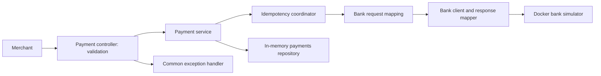

# Architecture and design decisions

This is a single-process assessment gateway, backed by the supplied bank simulator.
The core processing and retrieval requirements are implemented. The decisions below
record the current behavior, including deliberate limits; they are not a claim of
production readiness.

## Request flow

POST validates first. With a key, the coordinator reserves the request or returns
its existing outcome. The first caller submits to the bank; on authorization or
decline the service creates a gateway UUID and stores only the masked response.
The controller retrieves that response and returns 201. GET reads the repository
and returns 200, or 404 for an absent UUID, without calling the bank.

## Decisions and tradeoffs

| Decision | Reason and consequence |
| --- | --- |
| Packages grouped into `payment`, `bank`, `observability` | Keeps responsibilities visible without adding build modules. Bank code does not depend on payment classes; the payment-owned mapper connects DTOs. |
| Java records for DTOs | Immutable value objects with explicit, redacted request `toString()` methods. Record construction does not run Bean Validation. |
| Validation at the controller only | `@Valid` rejects requests before bank calls. Direct service callers must provide validated data. Response annotations are not automatically executed. |
| Explicit bank request/response DTOs | Documents the external contract without loosely typed request maps. A separate response mapper checks JSON types rather than accepting Boolean coercion. |
| Shared `PaymentResponse` record for POST and GET | Both endpoints expose the same masked payment details. One record removes the unused duplicate and keeps validation and serialization consistent. Split the contracts later only if their requirements diverge. |
| ConcurrentHashMap repository | Thread-safe individual reads/writes, sufficient for the assessment. It provides neither durability nor a transaction with the bank. |
| Atomic key reservation and shared future | Same-key concurrent requests share one attempt; distinct keys do not hold a common lock while calling the bank. |
| HMAC-SHA256 request fingerprint | Compares all payment fields without retaining the raw request in the key cache. The secret is random and instance-local. The request still exists transiently during processing. |
| Cache successful and failed key outcomes | Prevents automatic resubmission of a potentially completed bank operation. Failure codes are retained without upstream exceptions or sensitive causes. |
| Synchronous RestTemplate, 10-second connect/read timeouts | Simple integration with safe error translation. Calls and replay waiters occupy request threads; there is no circuit breaker, bulkhead or retry loop. |
| Fixed metric names and bounded labels | Makes operational behavior visible without payment IDs, keys or card data in metric labels. Correlation IDs link logs instead. |
| Multi-stage Docker build and non-root runtime | Runs tests during image creation and ships a JRE plus executable JAR. Compose sets the bank's service hostname and checks gateway readiness. |

## API assumptions

- Currency is exactly one of uppercase GBP, USD or EUR, fulfilling the three-code
  limit. Unsupported ISO codes are rejected too.
- Card number is 14-19 ASCII digits and CVV is 3-4 ASCII digits. No Luhn validation
  is added because the assessment does not request it.
- Combined expiry month/year must be strictly later than the current month.
- Amount is a Java Integer in minor units. Zero and negative values are currently
  accepted; the assessment specifies integer presence but no positive-only rule.
- Request JSON uses snake_case for card/expiry fields; payment responses use the
  existing camelCase contract. The gateway returns its own UUID, not the bank's code.
- 201 means a processed payment, including a decline. 400 Rejected means invalid
  input. Bank technical failures use code/message bodies with 502, 503 or 504.
- The optional idempotency key compares full payment details, including CVV. No key
  means an independent attempt. Keys are not merchant-scoped or application-length
  validated; blank keys currently participate in coordination like other strings.

## Known limitations and follow-up work

1. **Durability and recovery:** payments, key reservations and fingerprints disappear
   on restart. An upstream success followed by a crash before storage is not
   recoverable. No distributed exactly-once guarantee, reconciliation or refund flow.
2. **Memory and capacity:** repository/cache entries have no TTL, eviction or size
   cap. There is no rate limiting or load/SLO validation. Concurrent tests establish
   observed behavior, not a proof of correctness under every schedule.
3. **Failure uncertainty:** a timeout can mean the bank processed a payment. Reusing
   a key replays the stored technical failure; using a new key can cause a new attempt.
   Unexpected internal failures reserve the key but have no custom public error DTO.
4. **Security and hosting:** no authentication, merchant isolation or TLS termination.
   Compose binds the gateway to loopback, but the supplied bank/admin ports remain
   published. Use synthetic data locally. Gateway redaction does not establish the
   simulator's retention/logging policy or any payment-compliance certification.
5. **Operations:** readiness does not probe the bank. Compose orders startup without
   checking simulator readiness. No tracing collector, Prometheus server, dashboards,
   configured alerts or automatic unhealthy-container recovery is provided.
6. **Build lifecycle:** base image tags and OS package versions are mutable. Java 17
   is selected by the Docker image; local Gradle needs JAVA_HOME configured. Dependency
   upgrades, vulnerability scanning and CI/release automation remain future work.
See [testing](testing.md) and [observability](observability.md) for reproducible
verification and operational guidance.
